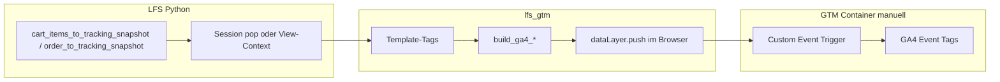
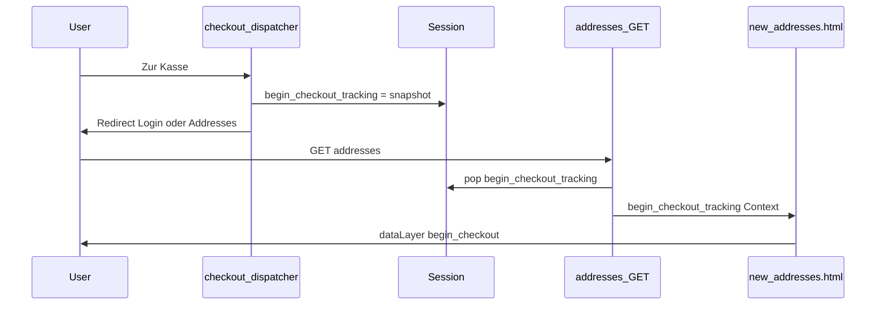

# LFS Google Tag Manager (`lfs_gtm`)

Django-App für **Google Tag Manager (GTM)** mit **Google Consent Mode v2**, Consent-Adapter für `lfs_cookie_consent` und Hilfen für **GA4-E-Commerce-Events** über den `dataLayer`.

Diese README beschreibt die **Integration im Shop** (am Beispiel HIG): welche Templates welche Events pushen, wie LFS und `lfs_gtm` zusammenarbeiten und was im **GTM-Container** manuell konfiguriert werden muss.

## Inhaltsverzeichnis

1. [Was dieses Paket tut — und was nicht](#was-dieses-paket-tut--und-was-nicht)
2. [Architektur (Variante B)](#architektur-variante-b)
3. [Installation und Konfiguration](#installation-und-konfiguration)
4. [Consent Mode und Script-Reihenfolge](#consent-mode-und-script-reihenfolge)
5. [Templates und dataLayer-Events](#templates-und-datalayer-events)
6. [E-Commerce-Events im Detail](#e-commerce-events-im-detail)
7. [begin_checkout: Warum Dispatcher und addresses?](#begin_checkout-warum-dispatcher-und-addresses)
8. [Session- und View-Muster](#session--und-view-muster)
9. [GTM-Container einrichten](#gtm-container-einrichten)
10. [Neue Events erweitern](#neue-events-erweitern)
11. [Tests](#tests)
12. [Lizenz](#lizenz)

---

## Was dieses Paket tut — und was nicht

### Enthalten in `lfs_gtm`

| Bereich | Inhalt |
|--------|--------|
| **GTM-Snippet** | ``, `` — Container laden, `dataLayer`, Consent-Defaults |
| **Consent-Adapter** | `lfs_gtm_consent.js` — reagiert auf `lfs:consent-changed`, aktualisiert Consent Mode, pusht Consent-Events, löscht GA/Ads-Cookies bei Widerruf |
| **GA4-Mapping** | `build_ga4_*` in `ga4_events.py` — tracker-neutrale Snapshots → GA4-`dataLayer`-Payloads |
| **Template-Tags** | `added_to_cart_script`, `begin_checkout_script`, `purchase_script`, `view_item_script`, `view_item_list_script`, generisch `datalayer_push` |

### Nicht in diesem Paket

- **Cookie-Banner und Modal** → [`lfs-cookie-consent`](../lfs-cookie-consent/) (UI + `lfs:consent-changed`)
- **GTM-Container-Konfiguration** im Google Tag Manager (Trigger, GA4-Tags, Variablen) — muss im Shop-Projekt manuell angelegt werden
- **Weitere GA4-Funnel-Events**, die in HIG noch fehlen: optional `view_cart` bei jedem Warenkorb-Besuch
- **`page_view`** — typischerweise über die GA4-Konfiguration in GTM, nicht über die E-Commerce-Tags hier

Es gibt **keine** Python-Abhängigkeit zu `lfs_cookie_consent`. Die Kopplung erfolgt nur im Browser über das Event `lfs:consent-changed` und ein festes `detail`-Format (siehe unten).

---

## Architektur (Variante B)

Shop-Logik (LFS) und Tracking-Adapter (`lfs_gtm`) sind getrennt:

1. **LFS** erzeugt **tracker-neutrale Snapshots** (keine GA4-Feldnamen, kein `event`-Key).
2. Snapshots werden per **Session** oder **View-Context** an das Template übergeben.
3. **`lfs_gtm`** mappt Snapshots auf GA4-Empfehlungs-Events und rendert ein Inline-Script, das `dataLayer.push(...)` ausführt.
4. Im **GTM-Container** reagieren Trigger auf die Custom-Event-Namen und feuern GA4-Tags.



**Vorteil:** LFS bleibt frei von Google-spezifischen Strukturen; ein anderer Tracker könnte dieselben Snapshots nutzen. GA4-Details liegen zentral in `ga4_events.py`.

---

## Installation und Konfiguration

### 1. Paket einbinden

`pip install lfs-gtm` installiert `lfs-cookie-consent` mit, denn ohne Einwilligung lädt GTM nichts. Beide kommen in
`INSTALLED_APPS` (`lfs_gtm` nach `lfs_cookie_consent`):

```python
INSTALLED_APPS = [
    # ...
    "lfs_cookie_consent",
    "lfs_gtm",
]
```

Bei lokaler Entwicklung (HIG) steht das Paket unter `src/lfs-gtm/` und wird per `sys.path` in `project/__init__.py` eingebunden.

### 2. Container-ID setzen

```python
GTM_ID = "GTM-XXXXXXX"
```

Ohne `GTM_ID` rendern `gtm_script`, `gtm_noscript` und E-Commerce-Tags **keinen** Output (``).

### 3. Static Files

```bash
python manage.py collectstatic
```

### 4. Abhängigkeit zu LFS

Die **Snapshots** werden in LFS erzeugt (`lfs.cart.utils.cart_items_to_tracking_snapshot`, `lfs.order.utils.order_to_tracking_snapshot`). Views speichern oder poppen Session-Keys und übergeben Context-Variablen an Theme-Templates. `lfs_gtm` selbst importiert LFS nicht — nur das Shop-Projekt verbindet beides.

---

## Consent Mode und Script-Reihenfolge

### Head: GTM + Consent-Defaults

`` (`templates/lfs_gtm/gtm_script.html`) legt an:

- `window.dataLayer` und `gtag()`
- **Consent Mode v2 Defaults** (Analytics/Ads zunächst `denied`, `wait_for_update: 500`)
- Laden von `https://www.googletagmanager.com/gtm.js`

### Body: Consent-Adapter

`static/lfs_gtm/lfs_gtm_consent.js` registriert einen Listener auf **`lfs:consent-changed`** (von `lfs_cookie_consent`) und:

- ruft `gtag('consent', 'update', { analytics_storage, ad_storage })` auf
- pusht Consent-Events in den `dataLayer`
- löscht Google-Analytics- bzw. Ads-Cookies, wenn die jeweilige Kategorie abgelehnt wird

### Browser-Vertrag (`lfs_cookie_consent`)

Beim Speichern von Consent (auch beim Seitenload, wenn Consent bereits gespeichert ist) muss ein **`CustomEvent`** `lfs:consent-changed` mit mindestens folgendem `detail` gefeuert werden:

| Feld | Typ | Bedeutung |
|------|-----|-----------|
| `necessary` | boolean | Immer `true` in der aktuellen UI |
| `analytics` | boolean | Einwilligung Messung/Analytics |
| `advertising` | boolean | Einwilligung Werbung |
| `timestamp` | number | Optional, ms seit Epoch |

### Pflicht-Reihenfolge im Theme (HIG: `lfs/base.html`)

Die Reihenfolge ist wichtig — der Consent-Adapter muss **vor** dem ersten `lfs:consent-changed` aus `init()` lauschen:

1. **`<head>`**, früh: ``
2. Cookie-CSS (`lfs_cookie_consent`)
3. **`<body>`**, direkt nach `<body>`: ``
4. Banner/Modal: ``, ``
5. Vor **`</body>`**, beide mit `defer`, in dieser Reihenfolge:
   - `lfs_cookie_consent.js`
   - `lfs_gtm/lfs_gtm_consent.js`

```django

<head>
    
    <link rel="stylesheet" href="">
</head>
<body>
    
    
    
    ...
    <script defer src=""></script>
    <script defer src=""></script>
</body>
```

### Consent-Events im dataLayer (kein E-Commerce)

| Quelle | `event` im dataLayer |
|--------|----------------------|
| `lfs_gtm_consent.js` | `analytics_consent_granted` / `analytics_consent_denied` |
| `lfs_gtm_consent.js` | `advertising_consent_granted` / `advertising_consent_denied` |

Diese Events eignen sich als **Custom-Event-Trigger** in GTM (z. B. zum Steuern von Tags oder als Zusatzbedingung neben Consent Mode).

---

## Templates und dataLayer-Events

Übersicht für **HIG** (`hig_theme`). Andere Themes müssen dieselben Tags an vergleichbaren Stellen einbinden.

| Template | Tag / Asset | GA4-`event` / Wirkung | Datenquelle (Python) | Wann |
|----------|-------------|------------------------|----------------------|------|
| `hig_theme/templates/lfs/base.html` | `` | — (lädt GTM) | `settings.GTM_ID` | Jede Seite |
| `hig_theme/templates/lfs/base.html` | `` | — (iframe-Fallback) | `settings.GTM_ID` | Jede Seite |
| `hig_theme/templates/lfs/base.html` | `lfs_gtm_consent.js` | Consent-Events (s. oben) | Browser: `lfs:consent-changed` | Consent speichern / laden |
| `hig_theme/templates/lfs/cart/cart.html` | `` | `add_to_cart` | Session, siehe [add_to_cart](#add_to_cart) | Einmal nach Hinzufügen + Redirect auf Warenkorb |
| `hig_theme/templates/lfs/checkout/new_addresses.html` | `` | `begin_checkout` | Session + View, siehe [begin_checkout](#begin_checkout) | Einmal bei **GET** des Adress-Schritts |
| `hig_theme/templates/lfs/checkout/thank_you_page.html` | `` | `purchase` | View `thank_you`, siehe [purchase](#purchase) | Einmal auf der Danke-Seite |
| `hig_theme/templates/lfs/catalog/product_base.html` | `` | `view_item` | View `product_view`, siehe [view_item](#view_item) | Einmal beim Laden der Produktseite (GET) |
| `hig_theme/templates/lfs/catalog/category_base.html` | `` | `view_item_list` | `category_products` / `category_view`, siehe [view_item_list](#view_item_list) | Kategorie mit Produktliste (GET, inkl. Pagination) |
| `hig_theme/templates/lfs/search/search_results.html` | `` | `view_item_list` | View `search`, siehe [view_item_list](#view_item_list) | Suchergebnisse mit Treffern (`q` nicht leer) |

**Noch nicht angebunden:** optional `view_cart` bei jedem Warenkorb-GET.

Technisch rendert jedes E-Commerce-Tag `datalayer_event_script.html`: JSON per `json_script`, dann `dataLayer.push(JSON.parse(...))`. Ohne `GTM_ID` oder leeren Snapshot wird **nichts** ausgegeben.

---

## E-Commerce-Events im Detail

### Tracker-neutrale Snapshots (LFS)

**Warenkorb** — `lfs.cart.utils.cart_items_to_tracking_snapshot(request, cart_items)`:

```python
{
    "currency": "EUR",
    "value": <Summe Brutto>,
    "line_items": [
        {"sku": "...", "name": "...", "price": <float>, "quantity": <int>},
        ...
    ],
}
```

Leerer Warenkorb → `None` (kein Event).

**Bestellung** — `lfs.order.utils.order_to_tracking_snapshot(order)`:

```python
{
    "order_id": "<Bestellnummer oder pk>",
    "currency": "EUR",
    "value": <order.price>,
    "tax": <order.tax>,
    "shipping": <order.shipping_price>,
    "line_items": [ ... ],
}
```

### Mapping in `lfs_gtm` (`ga4_events.py`)

| LFS-Snapshot | Builder | GA4 `event` | `ecommerce`-Felder (Auszug) |
|--------------|---------|---------------|-----------------------------|
| Cart | `build_ga4_add_to_cart` | `add_to_cart` | `currency`, `value`, `items[]` |
| Cart | `build_ga4_begin_checkout` | `begin_checkout` | wie oben |
| Cart / Produkt | `build_ga4_view_item` | `view_item` | wie `add_to_cart` (ein Artikel, `quantity: 1`) |
| Produktliste | `build_ga4_view_item_list` | `view_item_list` | `item_list_id`, `item_list_name`, `currency`, `value`, `items[]` |
| Order | `build_ga4_purchase` | `purchase` | `transaction_id`, `value`, `tax`, `shipping`, `items[]` |

`items[]` werden aus `line_items` gemappt: `item_id` ← `sku`, `item_name` ← `name`, `price`, `quantity`.

Leere oder ungültige Snapshots → Builder gibt `None` zurück → Template rendert kein Script.

### add_to_cart

**Ablauf:**

1. `lfs.cart.views.add_to_cart` speichert nach erfolgreichem Hinzufügen:
   - `request.session["added_to_cart_tracking"] = cart_items_to_tracking_snapshot(...)`
2. Redirect (typisch) zur Warenkorb-Seite.
3. `lfs.cart.views.cart` macht `request.session.pop("added_to_cart_tracking", None)` und übergibt den Wert als Context.
4. `cart.html`: ``.

Damit feuert `add_to_cart` **nicht** bei jedem Warenkorb-Besuch, sondern nur nach einer Add-to-Cart-Aktion (ein Pop pro gespeichertem Snapshot).

### begin_checkout

Siehe ausführlich [Abschnitt 7](#begin_checkout-warum-dispatcher-und-addresses).

Kurz: Snapshot wird beim Klick „Zur Kasse“ in der Session gelegt, auf der Adressen-Seite (**GET**) gepoppt und im Template gepusht. **POST** auf Adressen liefert kein `begin_checkout` (Formular-Submit).

### purchase

**Ablauf:**

1. Nach erfolgreicher Bestellung liegt die Order in der Session (Key `order`).
2. `lfs.checkout.views.thank_you` poppt `order` und baut `order_tracking = order_to_tracking_snapshot(order)`.
3. `thank_you_page.html`: ``.

Ohne Order in der Session (direkter Aufruf der Danke-URL) → kein Kauf-Event.

### view_item

**Angezeigtes Produkt:** `lfs.catalog.utils.get_display_product(request, product)` — gleiche Regel wie `product_inline` (Elternprodukt → Default-Variante).

**Snapshot:** `lfs.catalog.utils.product_to_tracking_snapshot(request, display_product)` — ein `line_items`-Eintrag wie beim Warenkorb.

**Ablauf:**

1. `lfs.catalog.views.product_view` setzt `product_tracking` im Context (angezeigte Variante via `get_display_product`).
2. `product_base.html`: ``.

### view_item_list

**Snapshot:** `lfs.catalog.utils.item_list_to_tracking_snapshot(request, products, list_id=..., list_name=...)` — mehrere Produkte der **aktuellen Seite** (Pagination, Filter, Sortierung wie in der Liste).

Zusätzliche Felder im Snapshot: `list_id`, `list_name` (→ GA4 `item_list_id`, `item_list_name`).

**Produktauflösung:**

| Kontext | Hilfsfunktion |
|---------|----------------|
| Kategorie-Liste | `resolve_product_for_category_list` — wie `category_products` (`get_variant_for_category`) |
| Suche | `resolve_product_for_search_list` — `get_display_product` (Default-Variante) |

**Kategorie mit Produkten:**

1. `category_products` baut `tracking_products` aus `current_page.object_list`.
2. Return-Dict enthält `item_list_tracking` (`list_id` = Kategorie-`slug`, `list_name` = Kategorie-`name`).
3. `category_view` übergibt Context; `category_base.html` rendert ``.

Nur bei `CONTENT_PRODUCTS`. Reine Unterkategorie-Ansichten ohne Produktliste → kein Event.

**Suche:**

1. `lfs.search.views.search` bei `q != ""` nach Pagination.
2. `list_id="search"`, `list_name` = Suchbegriff.
3. `search_results.html`: ``.

Leere Suche → kein Snapshot.

**Pagination:** Jede Seite (`?start=2`) = neues `view_item_list` mit den Produkten dieser Seite.

### Kein `view_item` bei Variantenwechsel (AJAX)

**Status:** Nicht implementiert (bewusst entfernt).

Produkte mit Varianten werden per AJAX aktualisiert (`select_variant`, `select_variant_from_properties` in `lfs.catalog.views`; Handler in `hig_theme/js/products.js`). Dabei wird nur das HTML in `#product-inline` ersetzt — **kein** zweites `view_item` im `dataLayer`.

**Was beim Seitenload passiert:**

- `view_item` feuert **einmal** für die beim GET angezeigte Variante (`get_display_product` → Default-Variante oder URL-Variante).
- Wählt der Nutzer danach eine andere Variante per Radio/Select, ändert sich die Anzeige, aber **nicht** das Tracking-Event.

**Warum kein AJAX-Tracking (derzeit):**

- Ein `` im per `innerHTML` eingefügten `product_inline` wird vom Browser **nicht ausgeführt** (Scripts in eingefügtem HTML laufen nicht).
- Ein separater Client-Push (`tracking_snapshot` in der JSON-Antwort + `dataLayer.push` in JS) war umgesetzt, hat in der Praxis aber zuverlässig nicht funktioniert und wurde wieder entfernt.

**Workaround für korrektes Tracking der gewählten Variante:** Direktlink zur Varianten-URL aufrufen oder Seite nach Variantenwahl neu laden (voller GET → neues `view_item`).

**Falls später nachgerüstet werden soll (Skizze):**

1. `product_to_tracking_snapshot` in `select_variant*` ins JSON (`tracking_snapshot`).
2. Nach erfolgreichem `fetch` in `products.js` `dataLayer.push` (Mapping wie `build_ga4_view_item` in `ga4_events.py`).
3. Kein Abhängigkeit von Scripts im AJAX-HTML; Preise im Snapshot als `float` für gültiges JSON.

---

## begin_checkout: Warum Dispatcher und addresses?

Eine häufige Frage: **Reicht es nicht, `begin_checkout` nur in `views_new.addresses` zu setzen** (z. B. Zeile mit `template_name="lfs/checkout/new_addresses.html"`)?

### Technisch: oft ja — mit Einschränkungen

Man *könnte* den Snapshot ausschließlich bei **GET** `addresses` aus dem aktuellen Warenkorb bauen und im Template pushen. Der vorhandene **Fallback** in `addresses` tut genau das, wenn die Session leer ist (z. B. direkter URL-Aufruf `/checkout/addresses`):

```python
begin_checkout_tracking = request.session.pop("begin_checkout_tracking", None)
if begin_checkout_tracking is None:
    begin_checkout_tracking = lfs.cart.utils.cart_items_to_tracking_snapshot(
        request, list(cart.get_items())
    )
```

Für den Normalfall „Warenkorb → Zur Kasse → (evtl. Login) → Adressen“ würde so **trotzdem** ein Event entstehen.

### Warum HIG zusätzlich `checkout_dispatcher` nutzt

Aktuelles Design:

| Schritt | Code | Wirkung |
|---------|------|---------|
| Nutzer klickt „Zur Kasse“ | `lfs.checkout.views.checkout_dispatcher` → `store_begin_checkout_tracking(request)` | `session["begin_checkout_tracking"] = snapshot` |
| Redirect | Login **oder** Adressen | Snapshot bleibt in der Session |
| **GET** Adressen | `lfs.checkout.views_new.addresses` | `pop("begin_checkout_tracking")` → Context → Template |
| **POST** Adressen | `addresses` | Kein Tracking-Context für `begin_checkout` |



**Gründe für Dispatcher + Session-Pop (nicht nur `addresses`):**

1. **Ein Event pro Checkout-Start**  
   Nach dem Pop ist der Session-Key weg. Reload der Adressen-Seite oder Zurücknavigation von „Versand & Zahlung“ erzeugt **kein zweites** `begin_checkout` — sofern kein neuer Dispatcher-Lauf den Key wieder setzt.  
   Ohne Session-Mechanismus würde **jeder GET** auf die Adress-URL erneut pushen.

2. **Semantik**  
   Dispatcher = Nutzer-Intent „Checkout starten“ beim Klick auf „Zur Kasse“.  
   Nur `addresses` = „Adressseite wurde geladen“ (Bookmark, Zurück, direkter Link).

3. **Login-Umweg**  
   Snapshot wird **vor** dem Login-Redirect gespeichert und überlebt die Session während des Logins.  
   **Trade-off:** Nach `update_cart_after_login` kann der Warenkorb abweichen; der Dispatcher-Snapshot ist dann theoretisch veraltet. Der Fallback in `addresses` (aktueller Warenkorb) mildert das bei leerem Session-Key — bei vorhandenem Key wird aber der ältere Snapshot gepoppt.

### Alternative: nur `addresses`

Wenn euch der Zeitpunkt „Adressseite sichtbar“ reicht und ihr Doppel-Fires verhindert, z. B. mit einem Session-Flag `begin_checkout_sent`:

- Dispatcher-Aufruf von `store_begin_checkout_tracking` entfällt.
- Snapshot immer aus dem Warenkorb beim ersten relevanten GET — oft **genauer nach Login**.
- Ihr müsst Reload/Zurück selbst per Flag absichern (gleiche Verantwortung wie heute der Pop).

Das aktuelle Muster entspricht **`add_to_cart`** und **`purchase`**: einmal schreiben (Action/Checkout-Start), einmal lesen und poppen (Zielseite).

---

## Session- und View-Muster

| GA4-Event | Session-Key setzen | Ausliefern | Pop |
|-----------|---------------------|------------|-----|
| `add_to_cart` | `add_to_cart` View | `cart` View → `added_to_cart_tracking` | `pop` in `cart` |
| `begin_checkout` | `checkout_dispatcher` → `store_begin_checkout_tracking` | `addresses` **GET** → `begin_checkout_tracking` | `pop` in `addresses`; Fallback ohne Key |
| `purchase` | Order in Session vor Redirect zu Thank-You | `thank_you` → `order_tracking` | `pop("order")` in `thank_you` |
| `view_item` | — | `product_view` → `product_tracking` | kein Session-Pop; ein Event pro Produktseiten-GET |
| `view_item_list` | — | `category_view` / `search` → `item_list_tracking` | kein Session-Pop; ein Event pro Listen-GET (Seite) |

Gemeinsames Prinzip bei Cart/Checkout/Purchase: **Schreiben an der Aktion**, **Lesen und Entfernen auf der Anzeige-Seite**, damit das Browser-Event nicht bei jedem erneuten Seitenaufruf wiederholt wird.

---

## GTM-Container einrichten

Alles Folgende passiert im **Google Tag Manager** (nicht im Python-Code).

### E-Commerce Custom Events

Für jedes vom Shop gepushte Event:

1. **Trigger:** Typ *Custom Event*, Event-Name exakt wie im `dataLayer` (`add_to_cart`, `begin_checkout`, `purchase`, `view_item`, `view_item_list`).
2. **Tag:** GA4-Event (oder GA4-E-Commerce über Variable), Parameter aus dem `ecommerce`-Objekt des dataLayer-Pushes mappen (`items`, `value`, `currency`, `transaction_id`, …).
3. **Consent:** Tags an **Consent Mode** und/oder eure Consent-Trigger koppeln (`analytics_consent_*`, `advertising_consent_*`), je nach Shop-Richtlinie.

### Consent-Events

Trigger auf `analytics_consent_granted` / `analytics_consent_denied` und `advertising_consent_*` können z. B. interne GTM-Logik oder zusätzliche Tags steuern. Consent Mode wird zusätzlich über `gtag('consent', 'update', …)` in `lfs_gtm_consent.js` gesetzt.

### page_view

Standard-**`page_view`** für GA4 kommt in der Regel über die **GA4-Konfiguration** im Container (All Pages) oder über automatische Erfassung — **nicht** über die E-Commerce-Tags in dieser App.

### Checkliste

- [ ] `GTM_ID` in Django-Settings gesetzt
- [ ] `gtm_script` / `gtm_noscript` / Consent-JS-Reihenfolge im Base-Template
- [ ] Trigger + GA4-Tags für `add_to_cart`, `begin_checkout`, `purchase`, `view_item`, `view_item_list`
- [ ] Consent mit Banner und Consent Mode abgestimmt
- [ ] Optional: Trigger für Consent-`dataLayer`-Events

---

## Neue Events erweitern

1. **LFS:** Tracker-neutralen Snapshot erzeugen (neue Hilfsfunktion oder Erweiterung bestehender).
2. **View/Session:** Snapshot wie bei den bestehenden Events setzen oder poppen.
3. **`lfs_gtm/ga4_events.py`:** `build_ga4_<name>(snapshot)` hinzufügen.
4. **`lfs_gtm/templatetags/lfs_gtm_tags.py`:** Simple-Tag, das `build_ga4_*` aufruft und `datalayer_push` nutzt.
5. **Theme-Template:** `` und neues Tag mit Context-Variable.

Generisch, wenn das Event-Dict schon fertig ist:

```django

```

---

## Tests

| Bereich | Pfad |
|---------|------|
| Paket `lfs_gtm` | `src/lfs-gtm/tests/` (`test_ga4_events.py`, `test_template_tags.py`) |
| LFS `begin_checkout` | `src/lfs/lfs/checkout/tests/test_begin_checkout_gtm.py` |
| LFS `add_to_cart` / Warenkorb | `src/lfs/lfs/cart/tests.py` (Session + HTML enthält `add_to_cart`) |
| LFS `purchase` | `src/lfs/lfs/order/tests.py` (Thank-You-Seite) |
| LFS `view_item` | `src/lfs/lfs/catalog/tests/test_product_tracking.py` |
| LFS `view_item_list` | `src/lfs/lfs/catalog/tests/test_item_list_tracking.py` |

Ausführen (Beispiel HIG, mit aktivierter `.venv`):

```bash
cd hig
pytest src/lfs-gtm/tests -q
pytest src/lfs/lfs/checkout/tests/test_begin_checkout_gtm.py -q
```

---

## Lizenz

MIT License
